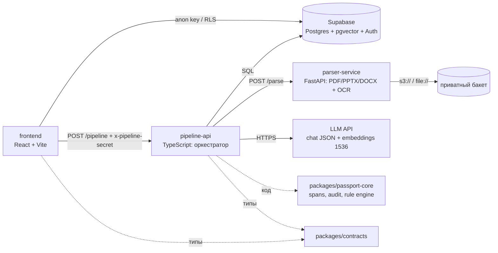

# Архитектура: Конструктор Паспорта Проекта — v1.0

Источник истины: ТЗ «Бэкенд и пайплайн Конструктора Паспорта Проекта (MVP v1.8)», DBML v1.8.

## 1. Компоненты v1.0



n8n в v1.0 не обязателен: логика блоков 1–5 ТЗ реализована в `pipeline-api` с тестами; n8n может вызывать тот же `POST /pipeline` (см. `backend/n8n/README.md`).

## 2. Структура

```
Accountant/
├─ package.json            npm workspaces: packages/*, backend/pipeline-api, frontend
├─ docker-compose.yml      parser + pipeline (Supabase отдельно)
├─ .env.example
├─ docs/architecture.md
├─ frontend/               UI (скелет; подключение к /pipeline — следующий этап)
├─ packages/
│  ├─ contracts/           enums, реестр 10 секций, контракт /pipeline
│  └─ passport-core/       calculateClaimSpans, auditClaims, evaluatePassportRules + тесты
└─ backend/
   ├─ supabase/
   │  ├─ migrations/       0001 enums · 0002 tables · 0003 функции/триггеры · 0004 RLS/grants
   │  └─ seed/             настройки и тарифы; 9000_* — dev-данные (только DEV_SEED=1)
   ├─ pipeline-api/        TS: handler, intake, passport, finalize, store, LLM, server + тесты
   ├─ parser-service/      FastAPI: /parse, /health; парсеры; тесты pytest
   ├─ kb/programs/student-startup/manifest.json   вопросы, примеры, критерии, правила
   └─ n8n/                 карта блоков ТЗ → модули (опционально)
```

## 3. Поток запроса (`handlePipeline`)

1. **Профиль и квота** — бан, файлы только на тарифе с `ai_parsing`, лимит `file_uploads_limit`, наличие ФИО.
2. **Ветка «Новый»** (нет проекта или якорь `pending`) — создаётся проект; если нет текста и файлов → `WAITING_FOR_INITIAL_BRIEF` (анкета из КБ, 0 токенов). Иначе: парсинг файлов (дедуп по sha256), LLM-выжимка брифа, эмбеддинг, `anchor_status = ready`, затем извлечение паспорта.
3. **Ветка «Есть»** — файлы (только новые); guard: эмбеддинг ввода (короткий ответ склеивается с вопросом) против якоря → `project_guard_events`; `blocked` → `BLOCKED_PROJECT_SWAP`. Далее:
   - `submit_answer` + `target_field` → валидация LLM по критериям КБ → сохранение поля и claims, либо `ANSWER_REJECTED`;
   - иначе новые данные → переизвлечение паспорта.
4. **Пробелы** — первый пустой или `needs_review` блок в порядке реестра → `NEED_USER_INPUT` (вопрос и пример из КБ).
5. **Новизна** (тариф с `novelty_check`) — LLM считает аналоги; < 2 → `STOP_NOV` (до `max_novelty_retries` = 2 раз), затем пропуск с предупреждением.
6. **Выход** — Rule Engine (детерминированно), навигатор (LLM: резюме + чек-лист), запись в section 0, статус проекта `review` → `COMPLETED`.

Пайплайн stateless: фронтенд передаёт `target_field` и `previous_question` (Вопрос 3, вариант А).

## 4. Где живёт логика

| Правило | Где | Проверка |
|---|---|---|
| Статусы review_status (ai_generated / needs_review / reviewed), сброс approved при правке | триггеры `0003` | `db.test.ts` |
| Спаны 0-based, orphaned при правке текста (Баг №2) | триггер `0003` + `spans.ts` | `db.test.ts`, `core.test.ts` |
| Span-расчёт при извлечении, аудит цитат и будущих дат | `passport-core` | `core.test.ts` |
| Guard (cosine similarity, пороги из app_settings) | SQL в `store.guardCheck` | `pipeline.test.ts` |
| Rule Engine (стоп-факторы, предупреждения) | `passport-core/rules.ts` | `core.test.ts` |
| Ошибки и коды ответа | `handler.ts`, `errors.ts`, `server.ts` | `server.test.ts` |

## 5. Исправления багов ТЗ

| # | Проблема | Как учтено в v1.0 |
|---|---|---|
| 1 | Холодный старт с пустым брифом | проект создаётся `pending`, анкета без записи якоря; якорь — при первом содержательном вводе |
| 2 | 1-based `strpos` vs 0-based спаны | `pos - 1` в SQL; TS-калькулятор 0-based; тесты |
| 3 | Нет `ai_generated`, `approved` не сбрасывался | триггеры `recompute_record_review_status` и `reset_approval_on_value_change` |
| 4 | Цикл STOP_NOV, тариф free | `novelty_check = false` пропускает шаг; лимит попыток `max_novelty_retries` |

## 6. Решения по открытым вопросам ТЗ (1.1)

| Вопрос | Решение v1.0 |
|---|---|
| 1. Анкеты и Rule Engine в КБ | JSON-манифест в репозитории (вариант А), без DDL-изменений |
| 2. Результаты скоринга | `project_passport_records`, `section_id = 0` (вариант А); там же счётчик попыток новизны |
| 3. Контекст вопроса | stateless: `target_field` + `previous_question` в каждом запросе |
| 4. Оркестрация скриптов | FastAPI для парсинга/OCR; span, audit и rules — TS-пакет, вызывается сервисом |

Отклонения от ТЗ, принятые в v1.0 (зафиксировать с заказчиком):
- Оркестратор — код `pipeline-api`, а не n8n. Контракт и блоки сохранены.
- Эмбеддинг якоря считается по тексту брифа (до 5000 символов), а не по выжимке — чтобы guard сравнивал сырой ввод с сырым якорем.
- Уникальность `(project_id, sha256_hash)` в `project_sources` — дедуп файла внутри проекта.
- `section_id = 0` используется для служебных записей (навигатор, счётчик попыток).

## 7. Что не сделано в v1.0

1. Подключение фронтенда к `/pipeline` и UI шагов (U_INIT, U_LOOP, STOP_NOV, COMPLETED).
2. Проверка JWT Supabase на входе (сейчас доверие к `user_id` через секрет шлюза).
3. Блокировка на проект (advisory lock) против параллельных запросов.
4. Реальный прогон на ключе OpenAI и на Supabase (в тестах — FakeLlm и PGlite; pgvector в локальном Postgres 17 не установлен).
5. OCR-сканы: нужен Tesseract в контейнере (есть в Dockerfile, локально не проверено).
6. Батчевый пересчёт статусов вместо построчных триггеров; перенос DDL в Supabase CLI-миграции (текущие файлы не идемпотентны).
7. Экспертная проверка формулировок вопросов и примеров в `manifest.json`.

## 8. Запуск и проверка

```bash
npm install
npm test                                   # vitest: passport-core, pipeline-api (БД в PGlite, FakeLlm)
cd backend/parser-service && python -m pytest
SUPABASE_DB_URL=... DEV_SEED=1 npm run migrate -w @passport/pipeline-api
docker compose up -d parser pipeline       # или локально: npm run start:pipeline
```
